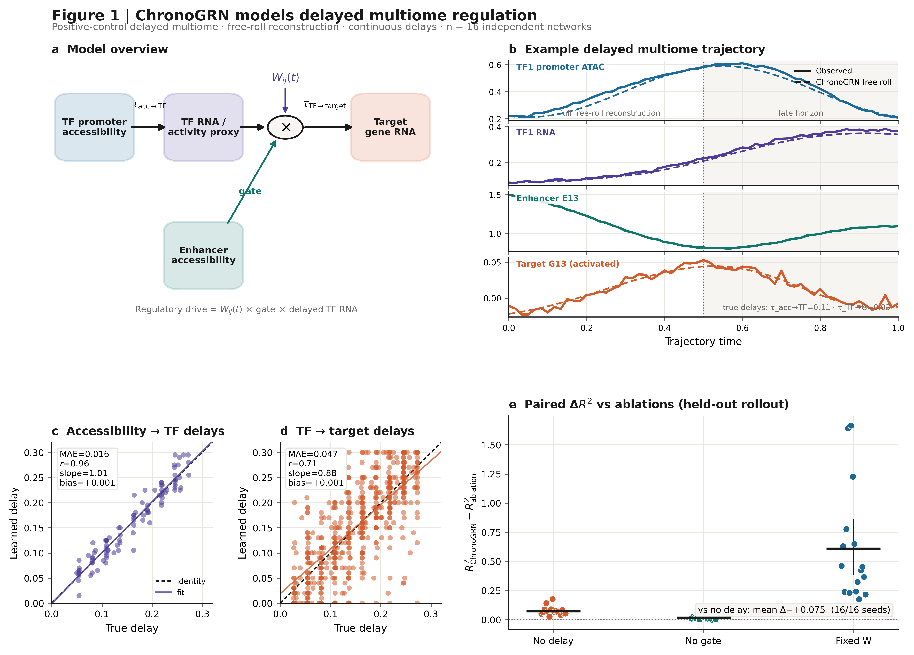
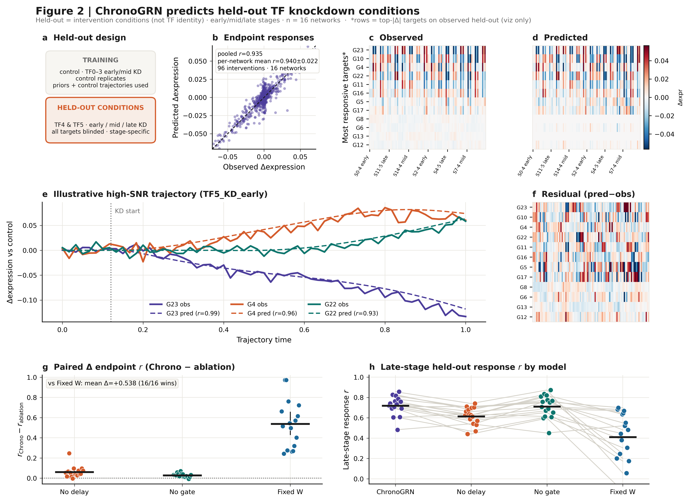
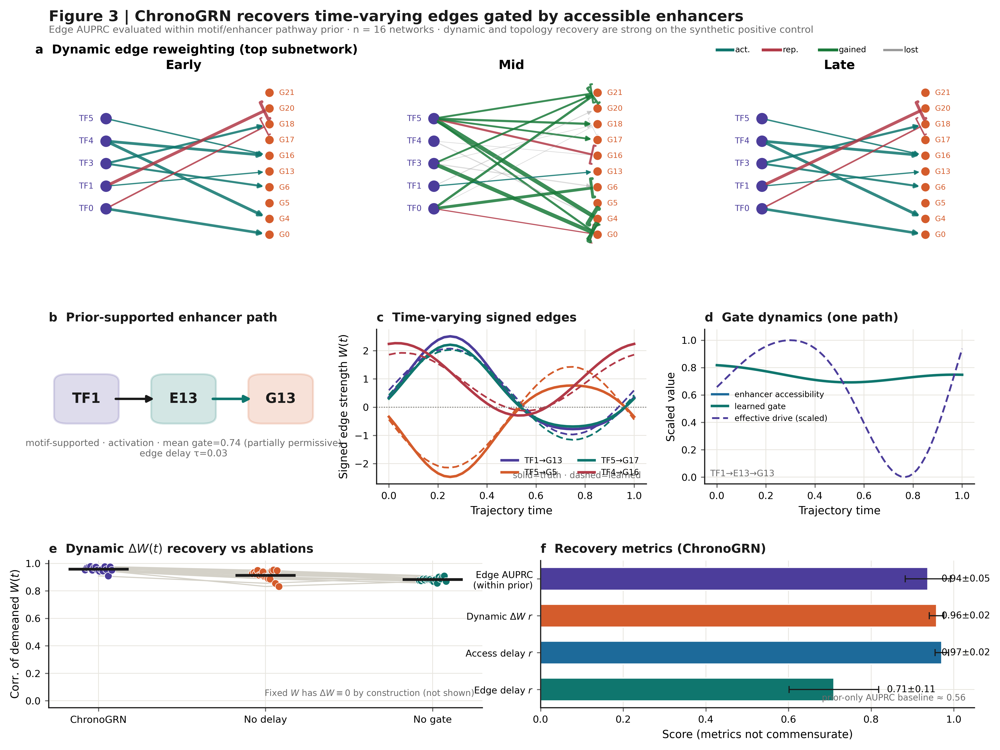

# ChronoGRN

Delay-aware, enhancer-gated, time-varying gene regulatory network (GRN)
inference from paired scRNA + scATAC (multiome) trajectories.

> Which TF regulates which target, through which accessible enhancer, at what
> stage, and after what delay?

ChronoGRN is a continuous-time state-space model. Its state is
`[TF promoter accessibility, TF RNA, enhancer accessibility, target RNA]`,
and target drive is

```
W_target,TF(t) · TF_RNA(t − τ_target,TF) · enhancer_gate(t)
```

Edges `W(t)` are time-varying, delays `τ` are learned per TF→target pair
(bounded, continuous), and enhancer accessibility gates whether a TF→target
path is usable at all.

## What's in this repo

This package is the **synthetic positive-control benchmark**: the exact
model code, data generator, fit pipeline, and 16 trained checkpoints used to
produce `results/figures/`. It answers "does this architecture
recover known ground truth under controlled conditions?" before any real
biology is involved — edges, delays, and held-out TF knockdown responses are
all *known* here, so recovery can be scored exactly instead of only
qualitatively assessed.

| | |
|---|---|
| Model code | [`src/causal_grn/`](src/causal_grn/) |
| Synthetic data generator | [`bench/delayed_multiome.py`](bench/delayed_multiome.py) |
| Fit + scoring pipeline | [`scripts/experiments/`](scripts/experiments/) |
| Figure builder | [`scripts/figures/build_figures.py`](scripts/figures/build_figures.py) |
| Trained checkpoints (16 seeds) | [`results/benchmark/`](results/benchmark/) |
| Demo (loads a checkpoint, reruns scoring live) | [`notebooks/demo.ipynb`](notebooks/demo.ipynb) |
| Figures | [`results/figures/`](results/figures/) |

## Design

Each of 16 independent random network seeds gets its own simulated ground
truth (`bench/delayed_multiome.py`): known edges, known continuous
accessibility→TF and TF→target delays, known time-varying edge dynamics
(early/late/transient/ramp classes), and known enhancer gating. Per seed:

- **Training conditions:** control + early/mid knockdown of TF0–TF3 +
  control replicates.
- **Held-out conditions:** early/mid/late knockdown of TF4–TF5 — stage
  matters, since the same TF knocked down early vs. late produces a
  different response, which is exactly what a fixed-edge (non-dynamic)
  model cannot capture.
- The held-out conditions are never used for fitting, hyperparameter
  selection, or checkpoint choice.

Fitting is the **training-only structured estimator**
(`fit_optimized_chronogrn`): Savitzky–Golay smoothing → ridge-regression
subsystem fits → profiled continuous delays → jointly fit static/dynamic
edge coefficients. Gradient fine-tuning is available but disabled by default
(`--finetune-epochs 0`) — on these short synthetic trajectories it did not
improve mechanistic identifiability over the structured fit.

## Results (n = 16 seeds, mean ± sd)

| Metric | Value |
|---|---:|
| Directed-edge AUPRC (within candidate prior; baseline 0.562) | 0.937 ± 0.055 |
| Dynamic edge-shape correlation (ΔW(t)) | 0.958 ± 0.018 |
| Accessibility→TF delay correlation | 0.971 ± 0.016 |
| TF→target delay correlation | 0.710 ± 0.108 |
| Control target reconstruction R² | 0.935 ± 0.017 |
| Late-horizon reconstruction R² | 0.891 ± 0.023 |
| Held-out endpoint response correlation | 0.940 ± 0.022 |
| Held-out full response-trajectory correlation | 0.702 ± 0.086 |
| Held-out target rollout R² | 0.855 ± 0.039 |
| Held-out sign accuracy (effectful targets) | 0.968 ± 0.043 |

### Paired ablations (same 16 seeds, held-out endpoint response r / rollout R²)

| Variant | Endpoint r | Rollout R² | Edge AUPRC |
|---|---:|---:|---:|
| **ChronoGRN (full)** | **0.940** | **0.855** | **0.937** |
| No delay | 0.879 | 0.780 | 0.901 |
| No enhancer gate | 0.912 | 0.839 | 0.954 |
| Fixed edges (no dynamics) | 0.402 | 0.247 | 0.701 |

Fixed edges collapses on held-out perturbation prediction (0.940 → 0.402):
this is the benchmark's central claim — time-varying, delay-aware edges are
what let the model generalize to a knockdown timed differently than
anything it trained on.

**Claim boundary:** these are controlled synthetic positive-control
identifiability results, not real-tissue validation. Motif/peak-to-gene
priors here are the generator's own ground-truth paths, not independently
measured biology. Edge-specific (TF→target) delay recovery is the weakest
mechanistic component (r ≈ 0.71) and should not be described as solved. For
a real-data fit (mouse gastrulation multiome + a sealed CRISPR knockout),
see the companion real-data results referenced in
[`docs/MODEL.md`](docs/MODEL.md).

### Figures

| | |
|---|---|
| **Figure 1** — Delayed multiome dynamics | What the model represents + delay recovery. |
| **Figure 2** — Held-out perturbations | Stage-specific (early/mid/late) TF4/TF5 knockdown prediction. |
| **Figure 3** — Dynamic GRN | Time-varying, enhancer-resolved edge recovery. |





## Quickstart — demo notebook

The 16 trained checkpoints are included (`results/benchmark/`),
so the demo reruns real scoring against the synthetic ground truth in
seconds, no training required:

```bash
git clone https://github.com/<your-org>/ChronoGRN.git
cd ChronoGRN
python -m venv .venv && source .venv/bin/activate
pip install -r requirements.txt
jupyter notebook notebooks/demo.ipynb
```

The notebook loads `results/benchmark/seed0.pt`,
regenerates seed 0's synthetic ground truth and data (deterministic from the
seed), calls the same `score_model` scoring function the benchmark uses, and
confirms the live numbers match the checkpoint's recorded metrics. It then
plots control-trajectory reconstruction, learned vs. true delays, and a
held-out stage-specific TF knockdown prediction.

## Reproduce from scratch

```bash
# 16 independent networks, structured fit (no gradient fine-tuning)
PYTHONPATH=src:. python scripts/experiments/run_optimized_benchmark.py \
  --seeds 0 1 2 3 4 5 6 7 8 9 10 11 12 13 14 15 \
  --time-frequencies 1 --finetune-epochs 0 --device cuda \
  --out results/benchmark

# Paired ablations (no delay / no gate / fixed edges)
PYTHONPATH=src:. python scripts/experiments/run_optimized_ablation_benchmark.py \
  --seeds 0 1 2 3 4 5 6 7 8 9 10 11 12 13 14 15 \
  --out results/ablation

# Figures
PYTHONPATH=src:. python scripts/figures/build_figures.py \
  --results results/benchmark \
  --ablation-results results/ablation/results.json \
  --out results/figures
```

Drop `--device cuda` to run on CPU (slower, but the 16-seed run completes in
minutes either way since trajectories are short and the default fit has no
gradient fine-tuning).

## Model API

```python
from causal_grn.checkpoint import load_checkpoint

model, payload = load_checkpoint("results/benchmark/seed0.pt")
metrics = payload["metrics"]           # this checkpoint's recorded benchmark scores

model.set_reference_trajectory(times, observed_states)   # anchor to a control trajectory
out = model.integrate(times, initial_state, method="heun")
out.obs                     # reconstructed states
out.edges                   # time-resolved TF->target edge weights
model.get_delays()          # {"access_to_tf": ..., "tf_to_target": ...}

# In-silico TF knockdown from a given time on
intervention = {"tf_index": 0, "start_time": 0.45, "scale": 0.0}
out_kd = model.integrate(times, initial_state, intervention=intervention)
```

See [`src/causal_grn/enhancer_model.py`](src/causal_grn/enhancer_model.py)
for the full `EnhancerDelayGRN` API and
[`bench/delayed_multiome.py`](bench/delayed_multiome.py) for how the ground
truth and synthetic observations are generated.

## Repo layout

```
src/causal_grn/            model + fit code (EnhancerDelayGRN, structured init, training loop, checkpoints)
bench/delayed_multiome.py  synthetic positive-control ground truth + data generator
scripts/experiments/       benchmark runner, paired ablations, scoring (score_model)
scripts/figures/           figure renderer
results/benchmark/         16 trained checkpoints + full per-seed metrics
results/ablation/          paired ablation metrics
results/figures/           the three figures above
notebooks/demo.ipynb       load a checkpoint and rerun scoring live
```

## Requirements

Python ≥3.10, PyTorch ≥2.1. See [`requirements.txt`](requirements.txt).

## License

[MIT](LICENSE).
